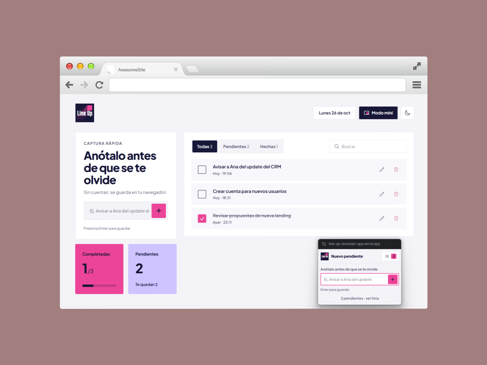

# Line Up

[English](README.md) · **Español**

<!-- portfolio:es -->
Anota pendientes rápidos sin iniciar sesión. Su modo mini abre una ventana flotante que se queda encima de tus llamadas, para anotar sin salir de la conversación.
<!-- /portfolio:es -->

**Demo:** [line-up-reminder-app.vercel.app/](https://line-up-reminder-app.vercel.app//)

Line Up nació para un momento muy concreto: estás en una llamada, sale un *action item* ("avisarle a Ana del update del CRM") y necesitas anotarlo **ya**, sin abrir otra app ni crear una cuenta. Escribes, presionas Enter y sigues en la conversación.



## Características

- **Captura en un paso**: un solo campo; Enter guarda.
- **Modo mini (Picture-in-Picture)**: una ventana flotante de 260×240 que se queda encima de Meet, Zoom o tu editor. Abre directamente en la vista para anotar y tiene un botón para ver la lista de pendientes y marcarlos como hechos. Sigue el tema de la página.
- **Tema claro y oscuro**: respeta la preferencia del sistema y recuerda la que elijas.
- **Filtros y búsqueda**: Todas / Pendientes / Hechas y búsqueda por texto.
- **Edición en línea**: edita un pendiente en su lugar (Enter guarda, Esc cancela).
- **Sin backend ni cuentas**: todo vive en `localStorage` y se sincroniza entre pestañas.
- **Responsivo**: en móvil, el campo para anotar queda fijo abajo, al alcance del pulgar.
- **Accesible**: botones reales con `aria-label`, etiquetas en todos los campos, foco visible y áreas táctiles de 44 px.

## Stack

- React 19 + Vite 8
- Tailwind CSS 4 (configuración en CSS con `@theme`, modo oscuro con `@custom-variant`)
- Heroicons
- ESLint 10 (flat config) con reglas de React Hooks
- [Document Picture-in-Picture API](https://developer.chrome.com/docs/web-platform/document-picture-in-picture)

## Cómo funciona el modo mini

Presiona **Modo mini** en el encabezado y se abre la ventana flotante. Para cerrarla, ciérrala como cualquier ventana.

`usePictureInPicture` abre la ventana con `documentPictureInPicture.requestWindow()` y le copia las hojas de estilo de la página. Después, `App` monta el componente `MiniWidget` dentro de esa ventana con `createPortal`. Como la ventana flotante es parte del mismo árbol de React, comparte el estado con la pestaña principal: lo que anotas en un lado aparece al instante en el otro, sin sincronización extra.

La API está disponible en Chrome y Edge de escritorio (116+). En otros navegadores el botón **Modo mini** simplemente no se muestra.

## Estructura

```
src/
├── main.jsx                # Punto de entrada
├── App.jsx                 # Composición de la página y portal del modo mini
├── components/
│   ├── header/             # Logo, fecha, botón Modo mini y cambio de tema
│   ├── quickCapture/       # Tarjeta de captura y CaptureInput reutilizable
│   ├── todoCounter/        # Tarjetas de completadas y pendientes
│   ├── filterTabs/         # Todas / Pendientes / Hechas
│   ├── todoSearch/
│   ├── todoList/
│   ├── todoItem/           # Pendiente con edición en línea y CheckButton
│   ├── miniWidget/         # Contenido de la ventana flotante
│   ├── icons/
│   └── footer/
├── hooks/
│   ├── useTodos.js         # Estado + localStorage + sincronización entre pestañas
│   ├── useTheme.js         # Tema claro / oscuro
│   └── usePictureInPicture.js
├── utils/date.js           # Fechas en español ("Hoy · 10:24")
└── css/App.css             # Tailwind: tema, colores de marca y modo oscuro
```

## Correr el proyecto

Requiere Node.js 20.19 o superior.

```bash
npm install
npm run dev      # http://localhost:5173
npm run build    # build de producción en /dist
npm run preview  # sirve el build localmente
npm run lint
```

## Despliegue

El proyecto está en Vercel. `vercel.json` usa el preset de Vite: corre `npm run build` y publica `dist/`.

## Autora

Desarrollado por **Génesis Guerrero** · [geneg.com.mx](https://geneg.com.mx) · [LinkedIn](https://www.linkedin.com/in/genesisd-guerrero/)
